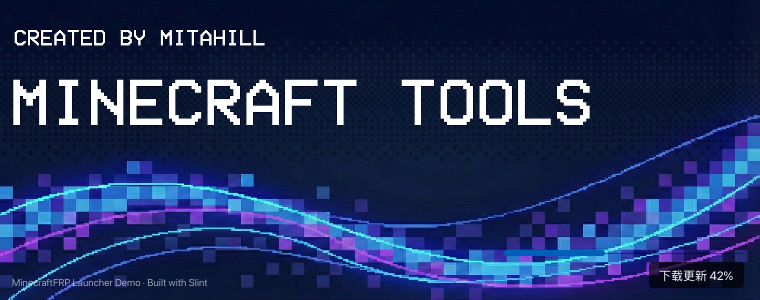
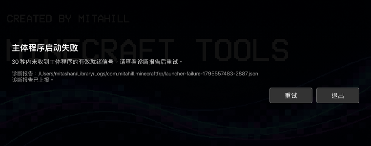

# Launcher

`launcher/` 实现 [客户端更新与节点构建计划](../docs/client-release.md) 中的启动和签名更新。使用 Rust + Slint（Winit 后端、软件渲染），打包后是单个本机可执行文件。

## 当前实现

已经跑通：

- 无边框开屏窗口，复用现有开屏图；右下角状态文字带局部深色衬底，下载时显示实际进度。
- 本机网络探测；明确断网时直接报错退出，不上报日志。
- 总控制端健康检查，首次失败后最多重试 10 次，每次间隔 3 秒，每次请求都有超时。
- `install.json` 记录所选通道、实际安装版本和构建通道；文件缺失或损坏时给出修复提示。
- dev/stable 通道规则：先查 dev；确认 dev 没有更高版本后才查 stable；dev 查询失败不回落。
- 用内置 Ed25519 公钥校验清单，按操作系统、架构和版本过滤。下载写入临时文件并显示实际进度，核对大小和 SHA-256。
- Launcher 以文件锁串行化更新。主体安装在独立版本目录，收到 `READY` 后原子更新 `install.json`。候选无法启动时恢复原主体。
- 启动真实 MinecraftTools 客户端或演示主体。30 秒内未收到带一次性随机值的 `READY` 即失败，主体提前退出时立即报错。
- 启动失败时保存本地诊断 JSON，再通过 HTTPS 上报；窗口显示错误摘要、报告位置和上报状态。
- 演示模式自带本地模拟服务、模拟更新包和演示主体程序，一条命令即可走完整流程。
- CI 在六个原生目标上编译 Launcher，与 Main App 一起打成 MSI、DMG 或 `.run`，并从安装后的入口冒烟到 Main App 发出 `READY`。

正式发布仍需完成：

- 同一安装的主体进程互斥和 Windows 文件锁测试。
- 体积上限和更新器自身升级。
- Slint 桌面免版税许可要求的署名。分发前需要在应用内加 `AboutSlint`，或在下载页放 Slint 徽标；也可以改用 GPLv3 或商业许可。
- 安装信息损坏或首次安装时的引导和修复流程。
- macOS Developer ID 签名与公证素材（当前安装包是 ad-hoc 签名）。

## 界面

改名前的原型截图，展示正常启动和启动失败。





## 运行演示

需要 Rust 1.95 或更新版本。依赖版本记录在 `Cargo.lock`。

```sh
cd launcher
cargo run --bin launcher -- --demo
```

演示会：

1. 在临时目录建立一套独立数据目录，不影响真实用户数据。
2. 启动只监听 `127.0.0.1` 的模拟服务，提供健康检查、dev/stable 元数据、更新包和诊断接收。
3. 使用本次演示的临时公钥验证清单，从 `2026-01-01-1` 更新到 dev 的 `2026-01-02-1`，显示实际进度并校验 SHA-256。
4. 解包并启动候选程序，收到 `READY` 后提交安装状态并关闭窗口。

控制台会打印本次演示数据目录和服务地址。

### 演示失败路径

演示主体程序读取环境变量 `DEMO_SUBJECT_MODE`：

```sh
# 主体程序在报告就绪前退出，触发诊断保存与上报
DEMO_SUBJECT_MODE=exit cargo run --bin launcher -- --demo

# 一直不发送 READY，触发 30 秒超时
DEMO_SUBJECT_MODE=never cargo run --bin launcher -- --demo

# 发送错误的一次性随机值，按超时处理
DEMO_SUBJECT_MODE=bad-token cargo run --bin launcher -- --demo
```

## 非演示模式

```sh
cargo run --bin launcher -- \
  --control-url http://127.0.0.1:8765 \
  --subject /path/to/MinecraftTools.app/Contents/MacOS/MinecraftTools
```

上例是 macOS 主体程序路径。Windows 和 Linux 传入对应的客户端可执行文件。Launcher 需要已有的 `install.json`。本地联调时，设置 `MINECRAFTTOOLS_DATA_ROOT` 指向临时目录，将下面的内容存为该目录下的 `install.json`：

```json
{"channel": "dev", "version": "2026-01-01-1", "build_channel": "stable"}
```

用[本地 Control Server](../control/README.md#验证-launcher)作为 `--control-url`。编译 Launcher 时通过 `MINECRAFTTOOLS_RELEASE_PUBLIC_KEYS` 内置与服务清单匹配的发布公钥。启动时先验签，再识别新版本或空通道。主体提前退出时，在临时数据目录的 `logs/` 和 Control Server 的 `control.db` 中均可查看报告。

## 流程

1. 检查本机网络。DNS 解析失败或本机没有可用出口时直接退出，不保存、不上报日志。
2. 请求 `{总控制端}/health`。首次失败后最多重试 10 次，每次等待 3 秒。
3. 读取 `install.json`，按实际安装版本判断更新。
4. 验证签名清单，下载候选包，核对大小与 SHA-256，再解到独立版本目录。
5. 启动主体程序，传入 `MINECRAFTTOOLS_LAUNCHER_PORT` 和 `MINECRAFTTOOLS_LAUNCHER_TOKEN`。
6. MinecraftTools 显示主窗口并进入 Qt 事件循环后，连回临时端口发送 `READY <token>`。30 秒内没有有效信号，或主体在就绪前退出，进入失败诊断。
7. 候选就绪后保存安装状态。候选启动失败时恢复原版本，再保存并上报诊断。

## 更新元数据格式

清单外层包含 `schema`、`key_id`、`payload`、`signature`。`payload` 和 `signature` 使用无填充 Base64URL，Ed25519 签名覆盖解码后的原始 JSON 字节。

```json
{
  "channel": "dev",
  "issued_at": 1760000000,
  "expires_at": 1762592000,
  "releases": [
    {
      "channel": "dev",
      "version": "2026-01-02-1",
      "os": "darwin",
      "arch": "arm64",
      "url": "https://example.com/downloads/MinecraftTools-update-2026-01-02-1-darwin-arm64.tar.gz",
      "size": 1048576,
      "sha256": "0123456789abcdef0123456789abcdef0123456789abcdef0123456789abcdef"
    }
  ]
}
```

`os` 用 `darwin`、`windows`、`linux`，`arch` 用 `amd64`、`arm64`，与现有构建脚本一致。版本号是 `yyyy-mm-dd-n`，按日期和当天序号比较。

总控制端接口：

| 方法 | 路径 | 说明 |
| --- | --- | --- |
| GET | `/health` | 任意 2xx 视为连通 |
| GET | `/releases/dev.json` | dev 更新元数据 |
| GET | `/releases/stable.json` | stable 更新元数据 |
| POST | `/diagnostics` | 接收启动失败诊断 JSON |

## 数据目录

与 [文档](../docs/client-release.md#客户端数据目录) 一致。`MINECRAFTTOOLS_DATA_ROOT` 可覆盖根目录，演示模式和测试用它隔离数据。

| 系统 | 配置和安装状态 | 日志 | 更新缓存 |
| --- | --- | --- | --- |
| Windows | `%LOCALAPPDATA%\MitaHill\MinecraftTools\` | 同目录 `logs\` | 同目录 `cache\` |
| macOS | `~/Library/Application Support/com.mitahill.minecrafttools/` | `~/Library/Logs/com.mitahill.minecrafttools/` | `~/Library/Caches/com.mitahill.minecrafttools/` |
| Linux | 配置 `$XDG_CONFIG_HOME/minecrafttools/`，状态 `$XDG_STATE_HOME/minecrafttools/` | `$XDG_STATE_HOME/minecrafttools/logs/` | `$XDG_CACHE_HOME/minecrafttools/` |

## 技术选择记录

```text
Need: 原生启动器窗口、HTTPS 请求、版本选择、下载校验和就绪握手
Checked: 现有 Python/PySide6 客户端（需要 Python、Qt），Rust 标准库（没有 GUI 和 TLS），
         文档指定的 Slint，以及 egui/iced 等可选 GUI
Candidates: Slint 1.19（Winit + 软件渲染）、egui、继续用 PySide6
Decision: Slint + ureq(rustls) + sha2 + serde_json + getrandom
Reason: 与文档首选方案一致；单个可执行文件，不需要用户安装运行环境；
        Slint 的软件渲染避免 OpenGL 依赖，许可证覆盖闭源桌面应用。
Impact: 只会新增 Rust 依赖，不引入外部服务或账号；桌面免版税许可需要署名。
Verification: `cargo test` 覆盖版本、通道、校验、握手和完整流程；
              `cargo run --bin launcher -- --demo` 在本机跑通启动和失败路径。
```

## 构建和测试

```sh
cd launcher
cargo test
cargo build --release
```

在本仓库里用根目录的 `dev.sh` 代替直接调用 cargo，`target/` 就会落到 `/tmp/minecrafttools-build/cargo-target` 而不是项目树，参数照常写：

```sh
./dev.sh cargo test --manifest-path launcher/Cargo.toml
./dev.sh cargo build --release --manifest-path launcher/Cargo.toml
```

`target/release/launcher` 是启动器，`target/release/demo-subject` 是演示主体程序。演示模式如果找不到同目录的 `demo-subject`，会以 `--demo-subject` 参数重新执行 Launcher 自身，所以只运行 `cargo run --bin launcher -- --demo` 也能完成演示。

在 macOS arm64 上实测：release 启动器约 8 MB（8,327,712 字节），演示主体约 296 KB（303,040 字节），两者压缩后约 5.9 MB；debug 启动器约 65 MB（含调试符号）。release 配置为 `opt-level = "z"`、`panic = "abort"`、LTO、`codegen-units = 1` 和 strip，并且只启用了 PNG 图片解码，避免带入其他格式。启动器内嵌的开屏图是 1520×600、约 1.1 MB 的 2x PNG；3.8 MB 原图仍保留在 `client/`，供 Python 客户端和后续设计使用。`target/` 只是本机构建缓存（曾约 6.5 GB），随用随删，不随发布分发。

继续压缩还可以考虑：

- 把开屏图换成同尺寸 WebP（约 91 KB），预计再省约 1 MB；需要把 `image` 的 feature 从 `png` 改成 `webp`。
- 用 `native-tls` 代替 `rustls`/`ring`，预计省 0.5–1 MB；代价是 Linux 构建需要 OpenSSL 开发库。
- 用 Cargo feature 把演示模拟服务从正式构建中排除，节省量不大，但能减少攻击面。
- UPX 能再压一半左右，但会破坏 macOS 签名和公证、增加启动开销，也可能触发杀毒软件误报，不建议用于正式发布。

`ui/splash.png` 是启动器专用素材，从 `client/src/minecrafttools/MinecraftToolsStartupLogo.png` 用 LANCZOS 缩到 1520×600（窗口 760×300 的 2x），原图不变。显示尺寸下与原图相比 PSNR 约 50 dB，肉眼无差异。更新原图后重新生成：

```sh
sips -z 600 1520 client/src/minecrafttools/MinecraftToolsStartupLogo.png --out launcher/ui/splash.png
```

如果后续同时要把 Python 客户端的包体也缩小，可以直接把 `client/src/minecrafttools/MinecraftToolsStartupLogo.png` 换成这份 2x PNG，并删掉启动器里的副本。

发布构建可以用环境变量 `MINECRAFTTOOLS_VERSION`（例如 `2026-11-25-1`）写入 Launcher 版本；未设置时诊断报告记录为 `0.0.0-local`。构建脚本目前没有把版本写进窗口标题或可见界面。

## 分段下载原型

`src/segmented.rs` 是 ureq 的分段多线程下载原型，不参与正式启动流程。ureq 本身没有并发分段或连接数爬坡；它只是单请求 HTTP 客户端，连接池只负责复用空闲连接。原型补上了这些逻辑：

- 先发 `Range: bytes=0-0` 探测服务器是否支持分段，同时记录总长度、ETag/Last-Modified。
- 预分配目标文件，工作线程从共享队列领取分片，用 `write_at` 按偏移写入。
- 连接数从 1 开始，每隔 `ramp_interval` 增加一个，直到 `max_connections` 或分片耗尽。
- 每个分片校验 `Content-Range`，带 `If-Range`，失败重试；服务器忽略 Range 时回退到单连接流式下载。
- 完成后重新读取文件计算 SHA-256。

运行：

```sh
cargo test --test segmented
cargo run --example segmented_download -- https://proof.ovh.net/files/10Mb.dat /tmp/10Mb.dat 5 2 300
```

本机受控服务（每 64 KB 延迟 10 ms，8 MiB 文件）实测：单连接 2.13 秒，4 连接 0.81 秒，连接数按 1→2→3→4 递增。公网 OVH 10 MiB 文件能正常爬坡到 5 连接并校验 SHA-256，但小文件下连接建立和爬坡开销会抵消收益；GitHub Release 的 8.4 MiB 资产经重定向后也能正确分段，爬坡到 4 连接。Cloudflare 的 Range 忽略场景会正确回退单连接。

当前上限是配置值，不是测量出来的“网络饱和点”。正式接入前还应补：按吞吐量停止或回退连接、续传元数据、取消、分片重试和总超时。ureq 只支持 HTTP/1.1，没有 HTTP/2 多路复用；连接建立成本和服务器/CDN 的限速策略会决定实际收益。原型未被启动流程引用，LTO 会移除未使用代码，release 产物体积保持 8,327,712 字节不变。

## 已知限制

- 健康检查和更新元数据使用固定超时，但重试期间不能从界面取消，只能强制关闭进程。
- 诊断上报失败时没有后台补传；报告留在本地。
- 只有 `READY` 一行协议，没有版本协商或心跳。
- 没有单实例锁。重复启动会创建多个 Launcher 窗口。
- 演示模式的模拟服务没有鉴权，只绑定回环地址，随进程退出。
